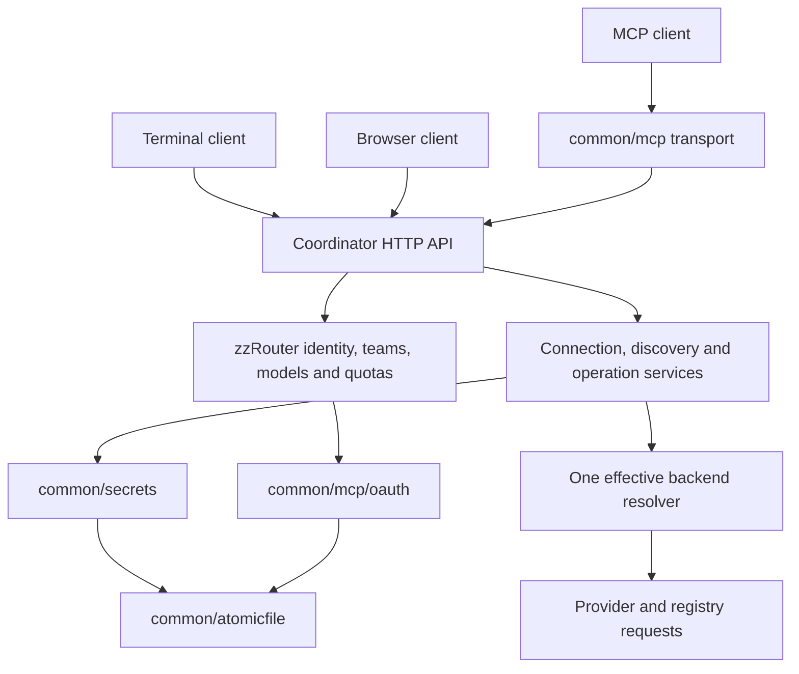

# Client and security boundaries

The terminal interface and browser are clients of the same coordinator services.
They share operations and results, while retaining navigation and presentation
suited to each interface. The [browser console](web-console.md) uses the existing
coordinator APIs; this document records the shared boundaries.

## Reusable Go code

Both zzRouter and zztrace already use `github.com/stperic/common/mcp`. New shared
packages have no imports from either application:

| Package | Shared responsibility | Application responsibility |
| --- | --- | --- |
| `common/mcp` | MCP transport, schemas and error conventions | Tool registration and dispatch |
| `common/mcp/oauth` | PKCE, resource-bound grants, refresh replay handling, browser sessions, CSRF, expiry, owner checks and revocation | Live identity lookup, resource permissions, trusted issuer and rendered pages |
| `common/secrets` | Authenticated encryption, protected key loading, revision checks, explicit ownership modes and rotation | Field schemas, permission checks, destination trust, external source resolution and activation |
| `common/atomicfile` | Atomic replacement, durability outcomes and exclusive writer locking | File location, lifecycle, backup and recovery policy |
| `common/httpclient` | Origin-bound redirects, including credential-bearing body replay | Initial server trust, TLS configuration and explicit unsigned CDN handling |

OAuth uses a comparable, JSON-serializable identity binding supplied by the
application. A binding contains stable identity and version references, never a
raw credential. Live resolution and permission callbacks run when authority is
used; a saved grant is not a copy of permissions that can outlive revocation.
Rendering belongs to the product and cannot set the authority's response policy.

zztrace can reuse these mechanisms for integration secrets and future HTTP
authentication. Its existing MCP transport uses stdio and Unix peer identity;
this refactor does not add browser login to zztrace. Its transaction-bound
tenant/project/actor/target/stage/operation/worktree/base/epoch and approval
provenance rules remain in zztrace. Router roles, model policy and quotas remain
in zzRouter. There is no second generic permissions database or policy engine.

Consumers pin a published immutable common version or commit before merging
their integration. Local development can use an explicit Go workspace; neither
repository commits a sibling `replace` directive.

## Connections and secrets

Provider definitions declare editable connection fields, validation, masking,
defaults for managed input and external variable names; external runtime
declarations keep their own inline defaults. All nine supported cloud providers and
Hugging Face use this contract. Multi-field providers retain their endpoint and
account fields. A credential always belongs to the complete connection snapshot.
Managed snapshots treat blank and undeclared variables as explicit empty values,
so dynamic metadata needs a declared field with an input value or default;
literal metadata headers remain unchanged.

`ProviderConnectionService` owns test, save, remove and external-ownership
operations. Controllers decode bounded requests and map errors. A candidate test
does not save or activate anything. Saves use the revision read by the client;
concurrent stale edits receive 409. A changed destination cannot silently reuse
a hidden secret. Redirects from credential tests are refused.

Managed values live in `credentials.enc`, protected by a separately provisioned
startup key. Ordinary provider configuration keeps declarations and references,
not resolved credentials. Removal stores a disabled tombstone so an old
environment/cache token cannot return. Restoring external ownership is explicit.
Secrets do not enter provider child environments, cluster synchronization, API
readbacks or ordinary configuration fingerprints.

The existing `backend.Resolver` captures endpoint, headers and revision together
for each operation. Inference, availability, search, cards, registry listing and
downloads use this owner. Authenticated caches include connection revision, so
an older in-flight request cannot populate a newer credential's cache.

Persistence, activation and cluster publication are separate effects. Mutation
responses expose `saved`, `durable`, `active`, `published` and `outcome`; clients
must not turn a saved-but-not-active result into an unconditional success or an
automatic retry. The encrypted file has atomic replacement, not a transaction
covering every configuration file and runtime effect. Native access, policy and
history stores acknowledge a committed replacement and log uncertain directory
durability, so one-time key results and cache publication are not lost after rename.

## Browser authority

Session/bootstrap/login/logout and `/me` routes expose safe metadata. The
HttpOnly session remains in a host-only cookie; JavaScript receives only a CSRF
proof. Mutations require the exact configured Origin and matching proof. API-key
credentials keep precedence, including invalid explicit credentials. Proxy
Authorization schemes such as Basic do not suppress cookie authentication; an
explicit Router key or malformed Bearer credential still refuses fallback. Normal
users can manage their own MCP grants and cannot enter admin operations.

Cookie authentication is enabled on management and access-control routes. MCP,
compatibility, cluster pairing and worker/internal routes retain their own
credential rules. Browser cookies are stripped on all upstream/cluster forwards,
including requests authenticated by an explicit API key. Internal worker log
requests carry only coordinator-owned metadata and use mTLS authority. MCP OAuth tokens remain
restricted to their MCP resource and never become general REST credentials.

The console's embedded, allowlisted assets live under `internal/server/web/console`.
Its HTTP adapter owns the session proof and request lifetimes. Provider forms
consume declared fields; access forms call KeysService/TeamsService routes.
The browser contains no provider implementation, secret store or permission
engine. `/me` explicitly projects existing key/team limits and allowed models;
own usage is obtained through KeysService. Full principals and node configuration
are never serialized to the browser.

Protected content is cleared before any session refresh. The adapter reads
bootstrap and `/me`, then confirms the proof stayed unchanged before installing
identity and CSRF together. Session-bound server proofs, page/form generations
and abort signals prevent old requests from acting as or rendering another
identity. An obsolete authorization error cannot clear a newer session. Neither
an uncertain write nor a rejected mutation is automatically replayed.

Window focus uses a non-destructive session probe. An unchanged issuer, signed
proof and authenticated state keep the current view; a changed observation
clears it before a full refresh. Probe failures preserve form/disclosure content
while blocking new mutations. Own-key rotation captures the existing issuer and
proof before submission: only that pending response and its one-time disclosure
may accept unauthenticated status with the same anchor. A changed anchor always
invalidates the owner, and a lost rotation response ends the exception.
Every one-time key result waits for the latest overlapping session probe before
presentation. Its existing pending-write owner remains active through read-only
verification retries; authority change or expiry aborts the wait and discards
the transient result. No raw value is retained in the operation tracker.

Effectful requests are tracked without retaining their payloads. Pending writes
block in-app navigation and warn on unload; diagnostic provider tests remain
cancelable. Unavoidable interruption records a generic outcome warning outside
the page/identity lifetime, so auth reset cannot erase it or expose old resource
details. Explicit refusals settle before auth-reset callbacks. Pagehide still
clears secrets, and no transient state is persisted in browser storage.

## Discovery and terminal ownership

The server supplies typed search/card metadata while retaining native provider
fields. It groups Hugging Face shards and feature files and fetches Ollama tags.
Unknown capacity remains evidence, not a download exclusion. Explicit download
selection uses node inventory with advisory fit; automatic all-node selection
retains the existing fit-only contract. Deployment admission stays on the server.

The TUI receives an already connected client. Search and selection requests carry
context and generation identity; late results and errors cannot overwrite a new
selection, including A-to-B-to-A navigation. Pending durable writes guard root
and local navigation until the bounded request settles. An uncertain response
requires state inspection before another attempt; diagnostic tests remain
cancelable. Leaving a view cancels observation,
while accepted server jobs continue. One multi-node deployment preserves its
deployment and per-node job IDs for subsequent observation.

Local search preferences use one ordered command writer across view activations.
ClientConfigStore owns immutable snapshots. ConfigManager serializes short
`cli.yaml` filesystem transactions across independent managers and processes
with `common/atomicfile.LockWait`, then atomically replaces the file. This native
lock wait cannot be canceled; manual external editors do not participate in the
advisory lock. Existing configuration reads need no write access; only creation,
save, reset and field mutations acquire the lock. Field changes preserve unrelated connection, chat and theme
settings. Provider and registry credentials remain coordinator operations.

See [configuration](configuration.md#managed-provider-and-hugging-face-credentials),
[security](security.md#managed-upstream-secrets), and [API reference](api.md#browser-sessions-and-provider-connections)
for the operator and client contracts. [Console workflows](web-console.md) and
terminal navigation use these same owners with interface-specific presentation.
